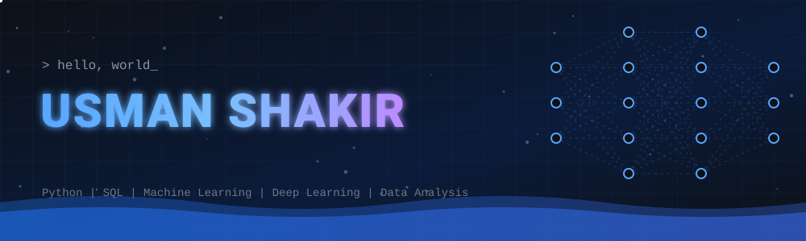
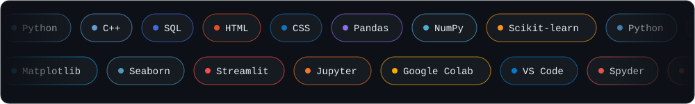
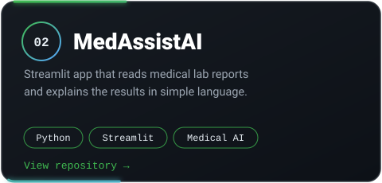

 

## About Me

I'm a **BS Data Science student** at **Dawood University of Engineering & Technology (DUET), Karachi**, and a **Data Science & Analytics Intern** at **DevelopersHub Corporation**.

I work with data to find patterns, build models, and create tools that are simple to use. I'm especially interested in **AI, Machine Learning, and Educational Technology**.

## Tech Universe

  

## Learning Path

## Featured Projects

<!-- TODO: replace both repository links above with the exact repo URLs -->

## Currently Working On

- Machine Learning projects with real datasets
- Deep Learning fundamentals
- Data visualization and dashboards
- Building my developer portfolio

## Let's Connect

I'm open to talking about data science, AI projects, and collaboration.

- LinkedIn: [usman-shakir7](https://www.linkedin.com/in/usman-shakir7/)
- GitHub: [Usmanshakir7](https://github.com/Usmanshakir7)

